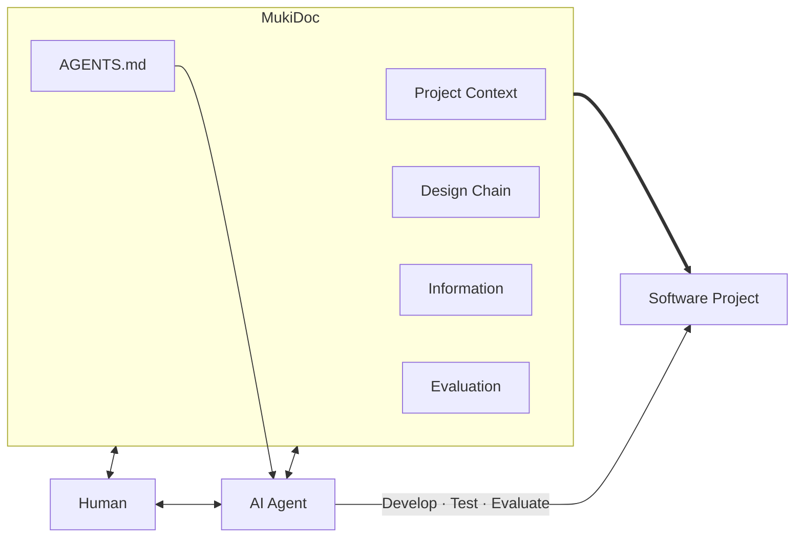
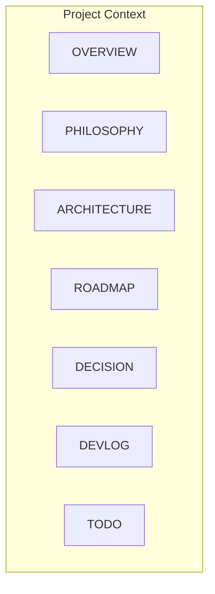
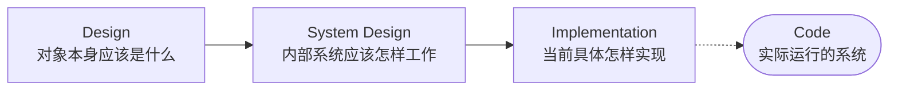
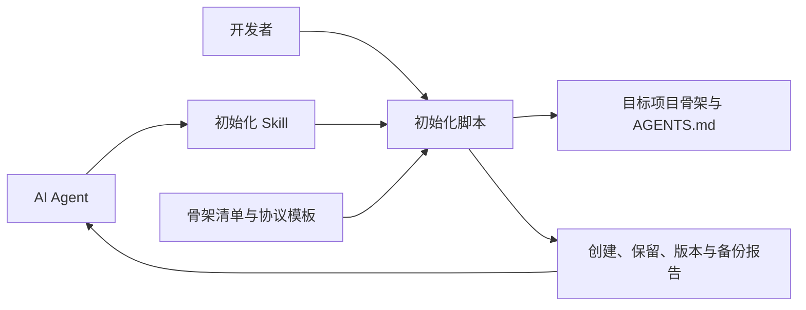
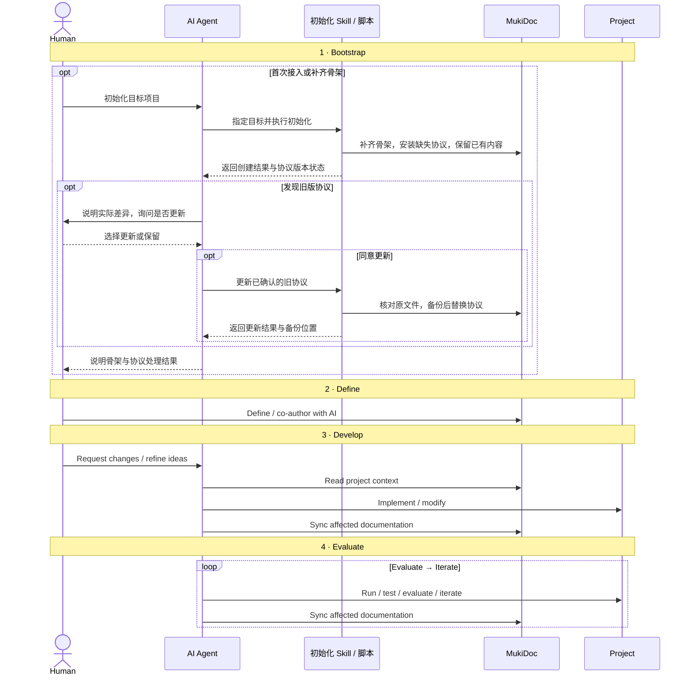

# Architecture

## 整体架构

MukiDoc 位于 Human、AI Agent 和实际软件项目之间，保存开发过程中需要长期存在的上下文。Human 和 AI 共同维护 MukiDoc，AI 根据其中的上下文开发、测试和评价实际项目，并在过程中持续同步文档。



## Project Context

Project Context 保存关于项目自身的权威描述：这个项目是什么、为什么这样做、内部如何组成、现在处于什么状态。Information 和 Evaluation 与它并列，不属于其中。前者是这些描述所依据的材料与证据，后者对这些描述中的承诺做出判断。



这些文档从不同角度维护同一份权威描述，使新的开发者或 AI 能够先建立整体认识，再进入具体设计和实现。

## 核心设计链

核心设计链由三个逐层细化、彼此解耦的层级组成。



上一层定义需要保持的语义和约束，下一层进一步决定如何实现。同一个 Design 可以对应不同的 System Design，同一个 System Design 也可以对应不同的 Implementation。

## Bootstrap 初始化

初始化 Skill 将目标目录与用户的协议更新选择交给脚本，脚本依据版本化资源包补齐骨架。人也可以直接运行同一脚本；目标项目无需访问 MukiDoc 的源规范。



初始化默认保留已有文件，旧协议更新经用户明确选择后先备份再替换。根目录 AGENTS.md 经导出器进入 Skill 的独立资源包；Skill 运行时使用随包版本，不查询在线最新版本。

## Runtime

从项目接入开始，一次完整过程包括 Bootstrap、Define、Develop 和 Evaluate 四个阶段。Bootstrap 建立固定骨架并处理协议版本；Human 随后与 AI 共同形成文档，AI 根据项目上下文完成实现并同步文档，再通过实际运行结果持续迭代。已有项目的日常开发可以直接进入后续阶段，无须每次重新初始化。



初始化只建立结构，不填充项目事实；保留旧协议不妨碍骨架补齐。上图以 Skill 入口和旧版更新为典型过程，开发者也可直接运行脚本；无版本、同版修改及更高版本的处理遵循 Bootstrap 的版本规则。日常开发中，人主要提出需求、形成判断并检查项目是否仍然符合意图；AI 负责读取上下文、向下细化、完成实现，并同步维护受到影响的文档。

## 架构树

1. Human
    1. 提需求、做判断、定方向，也可以直接参与文档编写。
    2. 主要通过 MukiDoc 理解和掌控项目，不需要长期记住代码细节。
2. AI Agent
    1. 细化设计，完成开发、测试和评价，并同步更新相关文档。
    2. AGENTS.md 由 MukiDoc 维护，为 Agent 提供固定的工作规则。
3. MukiDoc
    1. Project Context
        1. README：项目入口。
        2. OVERVIEW：项目是什么。
        3. PHILOSOPHY：为什么这样做。
        4. ARCHITECTURE：系统整体怎么组成。
        5. ROADMAP：项目长期怎么发展。
        6. DECISION：重要决策是怎么得出的。
        7. DEVLOG：开发过程中实际发生了什么。
        8. TODO：现在到哪、接下来做什么。
    2. Design Chain
        1. Design：设计这个东西本身应该是什么样。
        2. System Design：设计内部系统应该怎样工作。
            1. 跨 Area 的 concern 放层根，可选：DATA_MODEL.md、RUNTIME.md。
        3. Implementation：决定当前具体怎样实现。
            1. 跨 Area 的 concern 放层根，可选：TECH_STACK.md、API.md。
        4. 三层纵向固定，每层内部按 Area 横向组织；Area 由项目自然形成，按需生长，不要求各层镜像。
    3. Information
        1. Raw Materials：保存项目早期讨论、原始需求、历史资料等有助于理解项目来龙去脉的原始上下文。
        2. External Information：保存外部资料，通常来自原文摘录、复制整理或 AI 调研总结。
        3. Investigations：保存针对真实问题的调查过程、关键发现和结论。
        4. Playground：保存探索性实验，以及尚未进入正式分类的松散思考。
    4. Evaluation
        1. 定义项目需要关注的评价维度，并交给程序或 Agent 自动评价。
        2. 评价结果用于驱动后续迭代，及时发现项目是否偏离目标。
    5. Bootstrap
        1. Skill：初始化入口与协议更新选择。
        2. 初始化脚本：检查路径、建立骨架、保留内容和备份替换。
        3. 资源包：版本、固定清单、骨架文档和完整协议。
        4. 导出器与测试：同步权威协议并验证交付行为。


## 文件结构

基础目录和骨架文档固定建立并保留，即使暂时为空。根目录 README.md、AGENTS.md 与 docs 下七份 Project Context 文档为固定文件；三层设计链、Information 的四类目录及 Evaluation 的四个承诺来源目录为固定入口。Area、具体设计文档和标注可选的文件按需创建。MukiCheck 尚未落地，不纳入当前初始化要求。

```text
/
├── README.md
├── AGENTS.md
│
├── docs/
│   ├── OVERVIEW.md
│   ├── PHILOSOPHY.md
│   ├── ARCHITECTURE.md
│   ├── ROADMAP.md
│   ├── DECISION.md
│   ├── DEVLOG.md
│   ├── TODO.md
│   │
│   ├── information/
│   │   ├── raw_materials/
│   │   ├── external_information/
│   │   ├── investigations/
│   │   └── playground/
│   │       └── ...
│   │
│   ├── design/
│   │   ├── <area>/            # 按 Area 组织，按需生长、不镜像
│   │   │   └── ...
│   │   └── ...
│   │
│   ├── system_design/
│   │   ├── DATA_MODEL.md      # 跨 Area 的 concern 放层根，可选
│   │   ├── RUNTIME.md         # 可选
│   │   ├── <area>/
│   │   └── ...
│   │
│   ├── implementation/
│   │   ├── TECH_STACK.md      # 可选
│   │   ├── API.md             # 可选
│   │   ├── <area>/
│   │   └── ...
│   │
│   └── evaluation/
│       ├── philosophy/
│       ├── design/
│       ├── system_design/
│       ├── implementation/
│       └── mukicheck/         # 设计位置，暂不要求初始化
│
├── skills/
│   └── mukidoc-init/
│       ├── SKILL.md
│       ├── agents/openai.yaml
│       ├── scripts/init_mukidoc.py
│       └── assets/
│           ├── manifest.json
│           └── template/
├── scripts/
│   └── sync_skill_assets.py
├── tests/
│   └── test_bootstrap.py
│
└── ...
```
